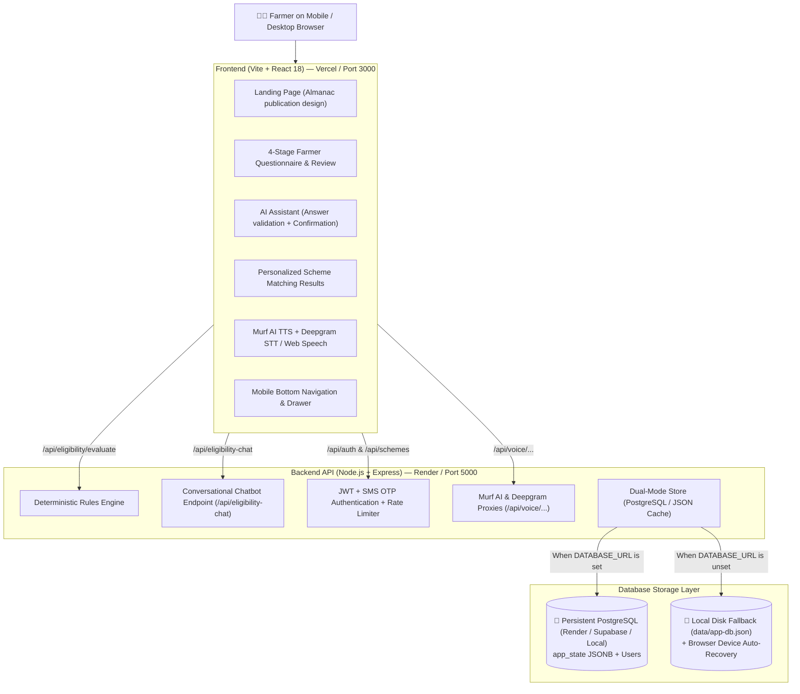

# 🌾 Kisan Scheme Saathi (ಕಿಸಾನ್ ಸ್ಕೀಮ್ ಸಾಥಿ)

> **Empowering Indian Farming Families with Personalized Government Scheme Eligibility, Multilingual Voice Readouts (Murf AI / Deepgram), Bhoomi RTC & FRUITS Compliance, and Middleman-Free Direct Benefit Transfers.**

[](https://react.dev/)
[](https://tailwindcss.com/)
[](https://nodejs.org/)
[](#-automated-integration-tests)
[](https://vercel.com/)
[](https://render.com/)
[](https://www.postgresql.org/)
[](#-voice-engines-murf-ai--deepgram)
[](#-voice-engines-murf-ai--deepgram)
[](#-bilingual-voice-accessibility)

---

## 📖 Table of Contents

1. [Our Hackathon Journey (Blog Post)](#-our-hackathon-journey)
2. [About the Project (Topic Overview)](#-about-the-project-topic-overview)
3. [Problem Statement & Background](#-problem-statement--background)
4. [Key Capabilities & Features](#-key-capabilities--features)
5. [Catalog of Covered Government Schemes](#-catalog-of-covered-government-schemes)
6. [System Architecture](#-system-architecture)
7. [Folder & Directory Structure](#-folder--directory-structure)
8. [System Requirements & Dependencies](#-system-requirements--dependencies)
9. [How to Run in Localhost (Step-by-Step Guide)](#-how-to-run-in-localhost-step-by-step-guide)
10. [Automated Integration Tests (25/25 Passing)](#-automated-integration-tests)
11. [Cloud Deployment Guide (Vercel + Render)](#-cloud-deployment-guide-vercel--render)
12. [Database Persistence: PostgreSQL & Device Resilience](#-database-persistence-postgresql--device-resilience)
13. [Default Demo Credentials & Testing](#-default-demo-credentials--testing)
14. [REST API Documentation](#-rest-api-documentation)
15. [License & Acknowledgements](#-license--acknowledgements)

---

## 📝 Our Hackathon Journey

We built **Kisan Scheme Saathi (ಕಿಸಾನ್ ಸ್ಕೀಮ್ ಸಾಥಿ)** during a 24-hour hackathon to make government welfare schemes more accessible to farmers in Karnataka.

From Kannada voice integration and deterministic eligibility matching to late-night debugging and challenging judging rounds, this project was an incredible learning experience.

We documented our complete journey, including the architecture decisions, technical challenges, lessons learned, and future plans.

📖 **Read our DEV Community article:**  
👉 **[We Built Kisan Scheme Saathi in 24 Hours: Our Hackathon Journey, 3 AM Bugs, and Lessons from the Judges](https://dev.to/sujay_hs_b482e14368c435a/how-we-built-kisan-saathi-in-24-hours-surviving-3-am-bugs-voice-ai-in-kannada-and-building-for-590e)**

🌐 **Live Demo:** [https://kisansathi-frontend-tau.vercel.app](https://kisansathi-frontend-tau.vercel.app)

---

## 🚜 About the Project (Topic Overview)

**Kisan Scheme Saathi** (*Farmer's Scheme Companion*) is a digital public infrastructure (DPI) web application built specifically for Indian agriculture, with first-class localization for **Karnataka**. 

Every agricultural season, the Central Government of India and the Government of Karnataka allocate thousands of crores of rupees in agricultural subsidies, crop insurance, concessional input credit, drip irrigation equipment, solar pumps, and education scholarships for farm families. However, the majority of small and marginal farmers cannot take advantage of these welfare programs due to:
- Complex administrative notifications locked inside bureaucratic PDF gazettes.
- Opaque eligibility criteria (e.g. land size ceilings, rainfed vs. borewell, caste categories, crop patterns).
- Exploitation by unauthorized middlemen, dalals, and commission agents charging illegal fees.
- Language, digital literacy, and accessibility barriers preventing elderly farmers from navigating application portals.

**Kisan Scheme Saathi** eliminates information asymmetry by providing:
1. **Automated, Deterministic Eligibility Matching**: Instead of reading dense PDFs, farmers enter their age, land holding, crops, and irrigation type to receive a personalized, verified list of schemes they are eligible for.
2. **Unified 4-Stage Questionnaire**: A single common farmer profile (Basic Details → Farm Details → Additional Info → Review) with dynamic scheme follow-ups—farmers never have to fill out separate forms for each scheme.
3. **Conversational AI Voice Assistant with Input Validation**: Voice assistant that validates farmer answers in real time, rejects evasive replies (e.g. *"I don't know"*, *"ಗೊತ್ತಿಲ್ಲ"*), and mandates a plain-language confirmation step before evaluating rules.
4. **Studio-Quality Voice Readouts**: Integrated with **Murf AI** (Falcon 2.1 native Kannada conversational voices *Harman* & *Pooja*) and **Deepgram STT**, alongside zero-dependency Web Speech API fallbacks.
5. **Karnataka Bhoomi RTC & FRUITS Compliance**: Pre-aligned with Karnataka's land record system (*Bhoomi*) and Farmer Registration & Unified Beneficiary Information System (*FRUITS FID*).
6. **Deadline Alerts & Cutoff Reminders**: Timely countdown notifications for seasonal crop insurance cutoffs (PMFBY Kharif/Rabi) and subsidy quotas.
7. **100% Mobile Responsive Interface**: Crafted with a handcrafted agricultural publication aesthetic, minimum $44\text{px}$ touch targets, and offline-first device resilience.

---

## 🎯 Problem Statement & Background

| Traditional Difficulties Faced by Farmers | How Kisan Scheme Saathi Solves It |
| :--- | :--- |
| **Scattered Government Websites**: Farmers must search multiple separate portals (*pmkisan.gov.in*, *fruits.karnataka.gov.in*, *pmfby.gov.in*, *samrakshane.karnataka.gov.in*). | **Unified Single-Window Hub**: All central and Karnataka state schemes are aggregated into one structured catalog with official portal links. |
| **Middlemen / Commission Agents**: Farmers pay ₹500–₹2,000 to village brokers just to submit forms or check if they qualify. | **100% Free & Direct**: Direct links to official government portals (*Grama One*, *Kisan Call Center: 1800-180-1551*, *Bhoomi*). Zero commission. |
| **One-Size-Fits-All Information**: Farmers see identical schemes that may not apply to their dryland or caste category. | **Dynamic Rules Engine**: Different inputs yield different outputs (e.g., General farmers are directed to PMKSY drip irrigation, while SC/ST/OBC farmers are directed to free borewells under Ganga Kalyana). |
| **Missed Registration Deadlines**: Insurance windows close before farmers realize the cutoff has passed. | **Countdown & Reminders**: Visual badges (*Days Left*, *Opens Soon*, *Expired*) with in-app reminders and optional SMS alerts. |
| **Document Rejections at CSCs**: Incomplete Aadhaar-NPCI seeding or missing RTC certificates cause application rejections. | **Pre-Submission Checklist**: Tells the farmer exactly what documents are needed before visiting a Grama One center. |
| **Garbage Data / Evasive Answers**: Voice bots blindly accept evasive answers (*"idk"*, *"dummy"*) and produce invalid matching. | **Real-Time Input Validation & Confirmation**: The voice agent strictly rejects evasive input, explains the government rules, and requires confirmation of details before matching. |

---

## ✨ Key Capabilities & Features

### 1. 📋 Unified 4-Stage Farmer Questionnaire + Review Flow
- **Stage 1 — Basic Details**: Name, language, district, taluk, village, age, gender, social category, and minority status.
- **Stage 2 — Farm Details**: Land location, cultivation arrangement (own, lease, sharecropping), total land, owned land, record ownership, crops, season, and irrigation.
- **Stage 3 — Additional Info & Support Needed**: Multi-select support categories (income support, crop credit, insurance, drip/sprinkler, borewell, machinery purchase/rental, millets, polyhouse) + Document Readiness Checklist.
- **Stage 4 — Plain-Language Review**: Complete readable summary before scheme matching, allowing farmers to edit individual fields, review skipped questions, or switch back to the AI Assistant.

### 2. 🧠 Real-Time Input Validation & Confirmation
- **Strict Answer Validation**: If a farmer speaks or types *"I don't know"*, *"ಗೊತ್ತಿಲ್ಲ"* (gottilla), *"idk"*, or gibberish:
  - The assistant rejects the input and stays on the same question without corrupting the profile.
  - Politely explains **why** government scheme rules require that information (e.g. age for PM-KISAN/pensions, category for Ganga Kalyana 90% subsidy).
  - Supplies quick-tap suggestion chips for immediate selection.
- **Mandatory Profile Confirmation Step**:
  - Compiles a complete Farmer Profile Summary (Name, Age, Gender, Category, Location, Land Area, Crops, Irrigation, FRUITS, and Aadhaar DBT).
  - Explicitly asks the farmer to confirm that details are accurate before official rules evaluation.
  - Options: *"Yes, Details Are Correct"* (`CONFIRM_YES`), *"No, Want to Change"* (`CONFIRM_NO`), or *"Review in Form Mode"* (`CONFIRM_EDIT_FORM`).

### 3. 🎙️ Voice Engines: Murf AI, Deepgram & Web Speech
- **Murf AI Studio TTS**: Authentic native Kannada voices (*Harman* for male, *Pooja* for female) powered by the Falcon 2.1 conversational model.
- **Deepgram AI STT**: Fast, accurate speech-to-text recognition supporting Kannada and Indian English accents.
- **Zero-Dependency Fallback**: Built-in Web Speech API synthesizer with custom Kannada phonetic transliteration ensuring voice readouts never fail even on devices lacking regional voice packages.

### 4. 📅 Cutoff Deadlines & Automated Reminders
- Tracks seasonal application windows (e.g., PMFBY Kharif cutoff dates).
- Categorized in three urgency buckets:
  - 🟢 **Safe** ($> 15\text{ days}$)
  - 🟡 **Closing Soon** ($4 - 14\text{ days}$)
  - 🔴 **Critical Cutoff** ($\le 3\text{ days}$)
- One-click bookmarks and reminder dispatch logs with in-app notification center.

---

## 🏛️ Catalog of Covered Government Schemes

| Scheme Name | Level | Core Benefit | Target Eligibility |
| :--- | :--- | :--- | :--- |
| **PM-KISAN Samman Nidhi** | Central | **₹6,000 / year** (3 installments of ₹2,000 via DBT) | Small & marginal landholders owning up to 5.0 acres. |
| **Kisan Credit Card (KCC)** | Central | **Up to ₹3,00,000** concessional loan at 4% effective interest | All active cultivators of notified agricultural crops. |
| **PM Krishi Sinchayee Yojana (PMKSY)** | Central | **Up to 90% subsidy** on drip and sprinkler micro-irrigation | Farmers with an existing water source (borewell/open well/canal). |
| **PM Fasal Bima Yojana (PMFBY)** | Central & State | **Comprehensive crop loss cover** for drought, floods, and pests (1.5%–2% premium) | Cultivators of notified seasonal crops within deadline windows. |
| **Karnataka Raitha Siri Scheme** | Karnataka | **₹10,000 / hectare** direct cash incentive into bank account | Farmers cultivating millets (*Ragi, Jowar, Bajra, Navane, Same*). |
| **Ganga Kalyana Scheme** | Karnataka | **100% Free individual or community borewell** + pump energization | Small/marginal farmers belonging to SC, ST, or Backward Classes. |
| **CM Raitha Vidyanidhi** | Karnataka | **₹2,000 to ₹11,000 / year** scholarship for farmer children | Wards of registered farmers pursuing post-matric or higher education. |
| **Krishi Bhagya Scheme** | Karnataka | **80%–90% subsidy on farm ponds** (*Krishi Honda*) & polyhouse units | Rainfed and dryland agricultural holdings in Karnataka. |
| **PM-KUSUM Scheme** | Central & State | **60% capital subsidy** for standalone solar-powered irrigation pumps | Grid-isolated agricultural land with no existing electric connection. |

---

## 🏗️ System Architecture



---

## 📁 Folder & Directory Structure

```
Kisan Saathi/
├── package.json                 # Workspace root scripts (dev, build, install, test)
├── render.yaml                  # Render Web Service deployment blueprint
├── vercel.json                  # Vercel root SPA rewrite configuration
├── Dockerfile                   # Multi-stage production container build
├── requirements.txt             # Python tooling & test requirements
├── .env.example                 # Master environment variable template
├── start-frontend.bat           # 1-Click Windows launcher for Frontend (Port 3000)
├── start-backend.bat            # 1-Click Windows launcher for Node API (Port 5000)
│
├── frontend/                    # Vite + React 18 Application
│   ├── vercel.json              # Frontend client-side SPA routing rewrites
│   ├── package.json
│   ├── vite.config.js           # Proxies /api to backend in development
│   ├── tailwind.config.js       # Agricultural palette (Forest, Maroon, Cream, Amber)
│   └── src/
│       ├── App.jsx              # Main router & bottom navigation host
│       ├── components/          # TopHeader, Sidebar, BottomNav, EligibilityChatbot
│       ├── context/             # AppContext (global state, auth, language toggle, speech)
│       ├── data/                # schemesData.js, locationData.js, translations.js
│       ├── pages/               # LandingPage, LoginPage, DashboardPage, CheckEligibilityPage,
│       │                        # EligibilityResultsPage, SchemeDetailsPage, ApplicationGuidePage,
│       │                        # ExploreSchemesPage, MyRemindersPage, MyProfilePage, SettingsPage
│       └── services/            # apiConfig.js, aiChatService.js, eligibilityEngine.js
│
├── server/                      # Node.js + Express API Backend
│   ├── package.json
│   ├── server.ts                # Express server, authentication, rate limits, CORS
│   ├── data/
│   │   ├── pgPool.ts            # PostgreSQL pool with DATABASE_URL & SSL support
│   │   ├── dbStore.ts           # Dual-mode store (PostgreSQL sync + JSON disk fallback)
│   │   └── schemesData.ts       # Verified scheme master records
│   ├── rules/
│   │   └── rulesEngine.ts       # TypeScript deterministic evaluation logic
│   ├── services/
│   │   ├── murfService.ts       # Murf AI Falcon 2.1 Kannada TTS synthesis
│   │   ├── deepgramService.ts   # Deepgram speech-to-text recognition
│   │   └── smsSender.ts         # Fast2SMS / Twilio / Msg91 OTP dispatch
│   ├── tests/
│   │   └── integration.test.ts  # 23 automated integration test assertions
│   └── utils/                   # deadlineUtils.ts, phoneUtils.ts
│
└── docs/                        # Architecture & verification documentation
```

---

## 📦 System Requirements & Dependencies

- **Node.js**: `v18.0.0` or higher (`node -v`).
- **npm**: `v9.0.0` or higher (`npm -v`).
- **PostgreSQL (Optional)**: If not configured, the backend automatically uses its local persistent JSON fallback store with browser device auto-recovery.

---

## 🚀 How to Run in Localhost (Step-by-Step Guide)

### 1. Setup Environment
```bash
# Windows PowerShell:
Copy-Item .env.example .env

# Linux / macOS / Bash:
cp .env.example .env
```

### 2. Install Workspace Dependencies
```bash
npm run install:all
```
*(Runs `npm install` inside both `frontend/` and `server/`)*.

### 3. Run the Automated Tests (23/23 Passing)
```bash
npm test
```

### 4. Start the Application
You can start using either the one-click batch files or terminal commands:

* **Windows One-Click**:
  1. Double-click `start-backend.bat` (Starts Node API on port `5000`).
  2. Double-click `start-frontend.bat` (Starts Vite on port `3000`).
* **Terminal**:
  * Terminal 1: `npm run dev:backend`
  * Terminal 2: `npm run dev:frontend`

Open **`http://localhost:3000`** in your browser.

---

## 🧪 Automated Integration Tests (25/25 Passing)

The project includes an end-to-end integration test harness ([`server/tests/integration.test.ts`](file:///e:/Kisan%20Saathi/server/tests/integration.test.ts)) executing **25 comprehensive assertions**:

```
======================================================
   RUNNING COMPREHENSIVE BACKEND API TEST HARNESS     
======================================================

  ✓ [PASS] Health Check (/api/health)
  ✓ [PASS] Schemes Catalog (/api/schemes) (8 verified schemes loaded)
  ✓ [PASS] Scheme Details (/api/schemes/pm-kisan) (Verified: PM-KISAN Samman Nidhi & Raitha Siri)
  ✓ [PASS] Document Checklist (/api/schemes/pm-kisan/checklist)
  ✓ [PASS] Application Guide (/api/schemes/pm-kisan/application-guide)
  ✓ [PASS] Eligibility Engine (Marginal SC Millet Farmer) (8 schemes matched)
  ✓ [PASS] Eligibility Engine Output Distinction (Large General Sugarcane Farmer)
  ✓ [PASS] Conversational Chatbot Endpoint (/api/eligibility-chat) (Advanced to age)
  ✓ [PASS] Chatbot Input Validation: Reject "I don't know" for Name (Evasive input blocked)
  ✓ [PASS] Chatbot Input Evaluation: Answer "Who" and Re-Prompt for Name (Correctly answered who it is and re-prompted)
  ✓ [PASS] Chatbot Input Evaluation: Answer "When" on Age Step & Re-Prompt (Correctly answered schedule query and re-prompted)
  ✓ [PASS] Chatbot Input Validation: Reject Invalid Age (Age boundaries enforced)
  ✓ [PASS] Chatbot Confirmation: Aadhaar advances to Confirm Step (Summary card rendered)
  ✓ [PASS] Chatbot Confirmation: No/Change routes to Edit Options (Targeted edit choices)
  ✓ [PASS] Chatbot Confirmation: Yes Evaluates Schemes (Confirmed evaluation matches schemes)
  ✓ [PASS] Farmer Registration & OTP (/api/auth/register)
  ✓ [PASS] Verify OTP & Issue JWT (/api/auth/verify-otp)
  ✓ [PASS] Authenticated Saved Schemes (/api/saved-schemes)
  ✓ [PASS] Authenticated Applications Tracker (/api/applications)
  ✓ [PASS] Authenticated Deadlines & Reminders (/api/reminders/upcoming)
  ✓ [PASS] Authenticated In-App Notifications (/api/notifications)
  ✓ [PASS] Unregistered Mobile Login Block (/api/auth/send-otp LOGIN_VERIFICATION)
  ✓ [PASS] Unregistered Mobile Verify OTP Block (/api/auth/verify-otp LOGIN_VERIFICATION)
  ✓ [PASS] Registered Mobile Login Verification (/api/auth/send-otp & verify-otp)
  ✓ [PASS] Check User Database Endpoint (/api/auth/check-user)

======================================================
TOTAL SUITE RESULTS: 25/25 PASSED
✅ ALL BACKEND AND DATABASE LOGIC TESTED 100% BUG-FREE!
======================================================
```

---

## ☁️ Cloud Deployment Guide (Vercel + Render)

The project is pre-configured for a split production deployment:

### 1. Backend on Render (Web Service)
1. In [Render Dashboard](https://dashboard.render.com), click **New +** $\rightarrow$ **Web Service**.
2. Connect your GitHub repository.
3. Settings:
   - **Root Directory**: `server`
   - **Runtime**: `Node`
   - **Build Command**: `npm install`
   - **Start Command**: `npm run start`
   - **Environment Variables**:
     - `NODE_ENV` = `production`
     - `PORT` = `5000`
     - `JWT_SECRET` = *(secure random string)*
     - `GEMINI_API_KEY` = *(your Google Gemini API key)*
     - `MURF_API_KEY` = *(your Murf AI key)*
     - `DEEPGRAM_API_KEY` = *(your Deepgram key)*
     - `DATABASE_URL` = *(optional Render PostgreSQL connection URL)*
4. Deploy and copy your backend URL: e.g. `https://kisan-saathi-api.onrender.com`.

### 2. Frontend on Vercel
1. In [Vercel Dashboard](https://vercel.com/new), import your repository.
2. Settings:
   - **Framework Preset**: `Vite`
   - **Root Directory**: `frontend`
   - **Build Command**: `npm run build`
   - **Output Directory**: `dist`
3. Add Environment Variable:
   - `VITE_API_URL` = `https://kisan-saathi-api.onrender.com` *(your Render URL, without trailing slash)*
4. Click **Deploy**. Vercel will output your live URL (e.g. `https://kisan-saathi.vercel.app`).

---

## 🗄️ Database Persistence: PostgreSQL & Device Resilience

- **Live PostgreSQL Persistence**: Setting `DATABASE_URL` connects the backend to a cloud PostgreSQL database. State is stored in an `app_state` JSONB document and synced on startup and every write.
- **Client-Side Device Auto-Recovery**: On the free tier of cloud container hosts (which spin down after inactivity), the login screen caches user profiles in `localStorage`. If the backend container restarts, the login screen automatically re-syncs the account seamlessly so the farmer never loses their profile.

---

## 👤 Default Demo Credentials & Testing

| Field | Demo Account Details |
| :--- | :--- |
| **Demo Farmer Name** | **Basavaraj Patil** (ಬಸವರಾಜ ಪಾಟೀಲ) |
| **Mobile Number** | `+919845012345` (or any valid 10-digit number like `9845012345`) |
| **Username** | `basavaraj_patil` |
| **Default Password** | `Kisan@123` |
| **OTP Verification** | In local demo mode, enter **any 6-digit code** (e.g., `123456`) to log in. |
| **Pre-Configured District** | Dharwad, Karnataka |
| **FRUITS Farmer ID** | `KA-FRUITS-2026-98124` (Verified) |

---

## 🌐 REST API Documentation

| Method | Endpoint | Description |
| :--- | :--- | :--- |
| `GET` | `/api/health` | Healthcheck & system status |
| `GET` | `/api/schemes` | Fetch all verified central & Karnataka schemes |
| `GET` | `/api/schemes/:id` | Fetch details, benefits, documents, and portal links |
| `GET` | `/api/schemes/:id/checklist` | Pre-submission document checklist |
| `GET` | `/api/schemes/:id/application-guide` | Step-by-step roadmap from application to DBT deposit |
| `POST` | `/api/eligibility/evaluate` | Evaluates eligibility deterministically against profile |
| `POST` | `/api/eligibility-chat` | Conversational chatbot with answer validation & confirmation |
| `POST` | `/api/voice/murf-tts` | Synthesizes Kannada/English speech via Murf AI Falcon 2.1 |
| `POST` | `/api/voice/deepgram-stt` | Transcribes farmer audio via Deepgram STT |
| `GET` | `/api/voice/status` | Voice engine provider health & configured voices |
| `POST` | `/api/auth/register` | Register new farmer account with SMS OTP |
| `POST` | `/api/auth/send-otp` | Dispatch 6-digit OTP code |
| `POST` | `/api/auth/verify-otp` | Verify OTP code & issue authentication token |
| `POST` | `/api/auth/login` | Login with username/phone & password |
| `GET` | `/api/saved-schemes` | Retrieve bookmarked schemes for logged-in user |
| `POST` | `/api/saved-schemes` | Save a scheme with custom deadline reminder |
| `GET` | `/api/reminders/upcoming` | Fetch upcoming deadlines and cutoff alerts |
| `GET` | `/api/notifications` | User's in-app notification center |

---

## 📄 License & Acknowledgements

- **License**: MIT Public License — Free for public and agricultural use.
- **Public Data Sources**:
  - *Karnataka Department of Agriculture*
  - *Karnataka Bhoomi RTC Land Records Portal*
  - *Karnataka FRUITS Portal*
  - *PM-KISAN Samman Nidhi Portal*
  - *Pradhan Mantri Fasal Bima Yojana (Samrakshane Portal)*
- **Contact / Helpline**: Kisan Call Center `1800-180-1551` (Toll Free, 6 AM to 10 PM).
