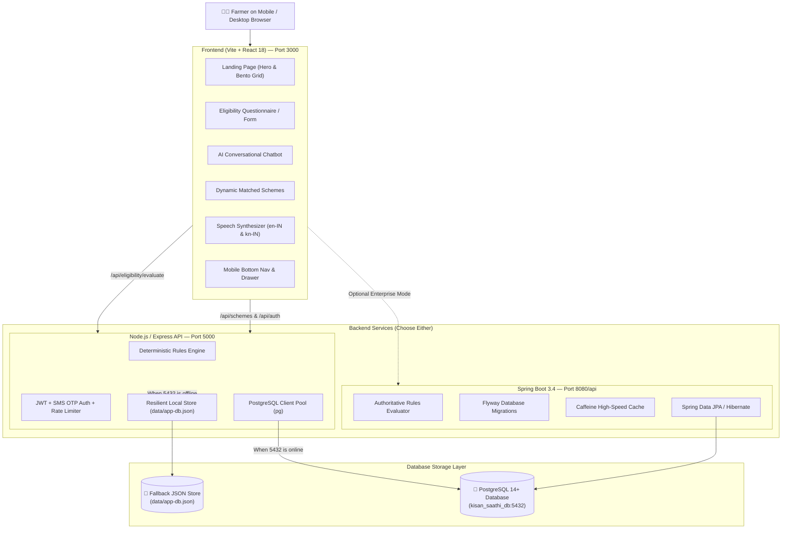

# 🌾 Kisan Scheme Saathi (ಕಿಸಾನ್ ಸ್ಕೀಮ್ ಸಾಥಿ)

> **Empowering Indian Farming Families with Personalized Government Scheme Eligibility, Multilingual Voice Readouts, Bhoomi RTC/FRUITS Integration, and Middleman-Free Direct Benefit Transfers.**

[](https://react.dev/)
[](https://tailwindcss.com/)
[](https://nodejs.org/)
[](https://spring.io/projects/spring-boot)
[](https://www.postgresql.org/)
[](#-mobile-first-experience)
[](#-bilingual-voice-accessibility)

---

## 📖 Table of Contents

1. [About the Project (Topic Overview)](#-about-the-project-topic-overview)
2. [Problem Statement & Background](#-problem-statement--background)
3. [Key Capabilities & Features](#-key-capabilities--features)
4. [Catalog of Covered Government Schemes](#-catalog-of-covered-government-schemes)
5. [System Architecture](#-system-architecture)
6. [Folder & Directory Structure](#-folder--directory-structure)
7. [System Requirements & Dependencies](#-system-requirements--dependencies)
8. [How to Run in Localhost (Step-by-Step Guide)](#-how-to-run-in-localhost-step-by-step-guide)
   - [Method 1: One-Click Batch Scripts (Fastest)](#method-1-one-click-batch-scripts-fastest)
   - [Method 2: Manual Terminal Commands](#method-2-manual-terminal-commands)
   - [Method 3: Running with Docker (PostgreSQL)](#method-3-running-with-docker-postgresql)
9. [Database Modes: PostgreSQL & Resilient Offline Fallback](#-database-modes-postgresql--resilient-offline-fallback)
10. [Default Demo Credentials & Testing](#-default-demo-credentials--testing)
11. [REST API Documentation](#-rest-api-documentation)
12. [Mobile-First Responsiveness](#-mobile-first-responsiveness)
13. [License & Acknowledgements](#-license--acknowledgements)

---

## 🚜 About the Project (Topic Overview)

**Kisan Scheme Saathi** (*Farmer's Scheme Companion*) is a digital public infrastructure (DPI) web application built specifically for Indian agriculture, with first-class localization for **Karnataka**. 

Every agricultural season, the Central Government of India and the Government of Karnataka allocate thousands of crores of rupees in agricultural subsidies, crop insurance, concessional input credit, drip irrigation equipment, solar pumps, and education scholarships for farm families. However, the majority of small and marginal farmers cannot take advantage of these welfare programs due to:
- Complex administrative notifications locked inside bureaucratic PDF gazettes.
- Opaque eligibility criteria (e.g. land size ceilings, rainfed vs. borewell, caste categories, crop patterns).
- Exploitation by unauthorized middlemen, dalals, and commission agents charging illegal fees.
- Language and literacy barriers preventing elderly farmers from reading application portals.

**Kisan Scheme Saathi** eliminates information asymmetry by providing:
1. **Automated, Deterministic Eligibility Matching**: Instead of reading dense PDFs, farmers enter their age, land holding, crops, and irrigation type to receive a personalized, verified list of schemes they are eligible for.
2. **Bilingual Natural Voice Synthesis**: Every scheme guideline, deadline, and eligibility reason is spoken aloud in clear, authentic Indian-accented English and Kannada.
3. **Karnataka Bhoomi RTC & FRUITS Compliance**: Pre-aligned with Karnataka's land record system (*Bhoomi*) and Farmer Registration & Unified Beneficiary Information System (*FRUITS FID*).
4. **Deadline Alerts & Cutoff Reminders**: Timely countdown notifications for seasonal crop insurance cutoffs (PMFBY Kharif/Rabi) and subsidy quotas.
5. **Interactive AI Eligibility Chatbot**: An accessible conversational assistant that guides farmers step-by-step through speech or quick option chips.
6. **100% Mobile Responsive Interface**: Optimized for finger reachability, touch screens, and slow rural 4G connections.

---

## 🎯 Problem Statement & Background

| Traditional Difficulties Faced by Farmers | How Kisan Scheme Saathi Solves It |
| :--- | :--- |
| **Scattered Government Websites**: Farmers must search multiple separate portals (*pmkisan.gov.in*, *fruits.karnataka.gov.in*, *pmfby.gov.in*, *samrakshane.karnataka.gov.in*). | **Unified Single-Window Hub**: All central and Karnataka state schemes are aggregated into one structured catalog with official portal links. |
| **Middlemen / Commission Agents**: Farmers pay ₹500–₹2,000 to village brokers just to submit forms or check if they qualify. | **100% Free & Direct**: Direct links to official government portals (*Grama One*, *Kisan Call Center: 1800-180-1551*, *Bhoomi*). Zero commission. |
| **One-Size-Fits-All Information**: Farmers see identical schemes that may not apply to their dryland or caste category. | **Dynamic Rules Engine**: Different inputs yield different outputs (e.g., General farmers are directed to PMKSY drip irrigation, while SC/ST/OBC farmers are directed to free borewells under Ganga Kalyana). |
| **Missed Registration Deadlines**: Insurance windows close before farmers realize the cutoff has passed. | **Countdown & Reminders**: Visual badges (*Days Left*, *Opens Soon*, *Expired*) with in-app reminders and optional SMS alerts. |
| **Document Rejections at CSCs**: Incomplete Aadhaar-NPCI seeding or missing RTC certificates cause application rejections. | **Pre-Submission Checklist**: Tells the farmer exactly what documents are needed before visiting a Grama One center. |

---

## ✨ Key Capabilities & Features

### 1. 🧠 Deterministic Rules-Based Eligibility Engine
- Zero LLM hallucinations for eligibility calculations.
- Evaluates rules deterministically:
  - **Land Holding**: Small/Marginal ($< 5\text{ Acres}$) vs Large ($> 5\text{ Acres}$).
  - **Social Category**: General, SC, ST, OBC (Category 1, 2A, 2B, 3A, 3B).
  - **Irrigation Source**: Borewell, Canal, Open Well, or Pure Rainfed/Dryland.
  - **Crop Types**: Millets (*Ragi, Jowar, Bajra*), Cereals, Horticulture, Cash Crops, Paddy.
  - **State & District**: Karnataka (all 31 districts) vs National programs.

### 2. 🔊 Bilingual Voice Accessibility (Kannada & Indian English)
- Integrated Web Speech Synthesizer calibrated for **Indian English (`en-IN`)** and **Kannada (`kn-IN`)**.
- Includes a custom Kannada phonetic transliterator (`transliterateKannada`) so that devices without a native Kannada TTS voice engine can still read aloud regional agricultural terms naturally without robotic failure.
- Features **Voice Speed Rate Control** (`0.8x`, `0.92x`, `1.1x`) and **Persona Selection** (Male: *Ravi/Prabhat*, Female: *Heera/Neerja*).

### 3. 💬 Conversational AI Eligibility Chatbot
- Step-by-step interview that gathers the farmer's profile naturally through interactive questions.
- Supports voice speech-to-text input (microphone), clickable quick answer chips, and typewriter text animation.
- Instant profile snapshot preview and immediate redirection to matched scheme results.

### 4. 📅 Cutoff Deadlines & Automated Reminders
- Tracks seasonal application windows (e.g., PMFBY Kharif cutoff dates).
- Categorized in three urgency buckets:
  - 🟢 **Safe** ($> 15\text{ days}$)
  - 🟡 **Closing Soon** ($4 - 14\text{ days}$)
  - 🔴 **Critical Cutoff** ($\le 3\text{ days}$)
- Allows farmers to toggle one-click reminders with notification dispatch logs.

### 5. 📱 Responsive Mobile Experience
- Dedicated bottom navigation bar (`BottomNav`) with 5 primary touch tabs (Home, Eligibility, Schemes, Reminders, Menu).
- Off-canvas slide-out drawer navigation (`Sidebar`) with backdrop overlay.
- Minimum $44\text{px}$ touch targets meeting accessibility guidelines for older farmers.

---

## 🏛️ Catalog of Covered Government Schemes

| Scheme Name | Level | Core Benefit | Target Eligibility |
| :--- | :--- | :--- | :--- |
| **PM-KISAN Samman Nidhi** | Central | **₹6,000 / year** (3 installments of ₹2,000 via DBT) | Small & marginal landholders owning up to 5.0 acres. |
| **Kisan Credit Card (KCC)** | Central | **Up to ₹3,00,000** concessional loan at 4% effective interest | All active cultivators of notified agricultural crops. |
| **PM Krishi Sinchayee Yojana (PMKSY)** | Central | **Up to 90% subsidy** on drip and sprinkler micro-irrigation | Farmers with an existing water source (borewell/open well/canal). |
| **PM Fasal Bima Yojana (PMFBY)** | Central & State | **Comprehensive crop loss cover** for drought, floods, and pests (1.5%–2% premium) | Cultivators of notified seasonal crops within deadline windows. |
| **Karnataka Raitha Siri Scheme** | Karnataka | **₹10,000 / hectare** direct cash incentive into bank account | Farmers cultivating millets (*Ragi, Jowar, Bajra, Navane, Same*). |
| **Ganga Kalyana Scheme** | Karnataka | **100% Free individual or community borewell** + pump energization | Small/marginal farmers belonging to SC, ST, or Backward Classes. |
| **CM Raitha Vidyanidhi** | Karnataka | **₹2,000 to ₹11,000 / year** scholarship for farmer children | Wards of registered farmers pursuing post-matric or higher education. |
| **Krishi Bhagya Scheme** | Karnataka | **80%–90% subsidy on farm ponds** (*Krishi Honda*) & polyhouse units | Rainfed and dryland agricultural holdings in Karnataka. |
| **PM-KUSUM Scheme** | Central & State | **60% capital subsidy** for standalone solar-powered irrigation pumps | Grid-isolated agricultural land with no existing electric connection. |

---

## 🏗️ System Architecture



---

## 📁 Folder & Directory Structure

```
Kisan Saathi/
├── package.json                 # Workspace root scripts (dev, build, install)
├── requirements.txt             # Python tooling & test requirements
├── .env.example                 # Master environment variable template
├── start-frontend.bat           # 1-Click Windows launcher for Frontend (Port 3000)
├── start-backend.bat            # 1-Click Windows launcher for Node API (Port 5000)
├── start-backend-java.bat       # 1-Click Windows launcher for Spring Boot (Port 8080)
│
├── frontend/                    # Vite + React 18 Application
│   ├── index.html
│   ├── package.json
│   ├── vite.config.js           # Proxies /api to http://localhost:5000
│   ├── tailwind.config.js       # Custom Indian agricultural palette (Forest, Maroon, Cream, Amber)
│   └── src/
│       ├── App.jsx              # Main router & bottom navigation host
│       ├── components/          # TopHeader, Sidebar, BottomNav, EligibilityChatbot, RubberSegment, Logo
│       ├── context/             # AppContext (global state, voice synthesizer, language toggle)
│       ├── data/                # schemesData.js, locationData.js, translations.js
│       ├── pages/               # LandingPage, LoginPage, DashboardPage, CheckEligibilityPage,
│       │                        # EligibilityResultsPage, SchemeDetailsPage, ApplicationGuidePage,
│       │                        # ExploreSchemesPage, MyRemindersPage, MyProfilePage, SettingsPage
│       └── services/            # eligibilityEngine.js (rules matcher), aiChatService.js
│
├── server/                      # Node.js + Express API Backend
│   ├── package.json
│   ├── server.ts                # Express server, authentication, rate limits, CORS
│   ├── data/
│   │   ├── pgPool.ts            # PostgreSQL pool with auto-fallback detection
│   │   ├── dbStore.ts           # Dual-mode store (JSON disk persistence + PG)
│   │   └── schemesData.ts       # Verified scheme master records
│   ├── rules/
│   │   └── rulesEngine.ts       # TypeScript deterministic evaluation logic
│   ├── services/                # smsSender.ts (Twilio / Msg91 / Fast2SMS)
│   └── utils/                   # deadlineUtils.ts, phoneUtils.ts
│
├── backend/                     # Java Spring Boot 3.4 Enterprise Backend
│   ├── pom.xml                  # Maven dependencies (JPA, Flyway, Caffeine, JJWT, Postgres)
│   └── src/
│       ├── main/java/com/kisanscheme/saathi/
│       │   ├── KisanSchemeSaathiApplication.java
│       │   ├── controller/      # REST endpoints (/schemes, /auth, /applications, /reminders)
│       │   ├── model/           # JPA Entities (User, SavedScheme, ApplicationRecord, etc.)
│       │   ├── repository/      # Spring Data Repositories
│       │   └── service/         # DeterministicEligibilityEngine, AuthOtpService, DeadlineScheduler
│       └── main/resources/
│           ├── application.properties
│           ├── schema.sql       # Authoritative PostgreSQL 14+ DDL schema
│           └── db/migration/    # Flyway versioned migrations (V1, V2)
│
├── data/
│   └── app-db.json              # Local persistent JSON database (auto-created on first run)
└── docs/                        # Architecture & verification documentation
```

---

## 📦 System Requirements & Dependencies

### 1. System Requirements
- **Operating System**: Windows 10/11, macOS, or Linux (Ubuntu 20.04+).
- **Node.js**: `v18.0.0` or higher (`node -v`).
- **npm**: `v9.0.0` or higher (`npm -v`).
- **Java (Optional for Java Backend)**: JDK 17 or JDK 21 LTS (`java -version`).
- **Maven (Optional for Java Backend)**: 3.8+ (`mvn -version`).
- **PostgreSQL (Optional)**: PostgreSQL 14+ or Docker (if not installed, the server seamlessly runs on the local fallback store).

### 2. Python Tooling Requirements (`requirements.txt`)
If you are running Python helper scripts, data analysis, or Gemini AI test scripts:
```bash
python -m venv venv
# On Windows:
venv\Scripts\activate
# On Linux/macOS:
source venv/bin/activate

pip install -r requirements.txt
```

The [`requirements.txt`](file:///e:/Kisan%20Saathi/requirements.txt) includes:
- `google-genai>=2.4.0` (Gemini API SDK for agricultural advisory)
- `psycopg2-binary>=2.9.9` (PostgreSQL client)
- `requests>=2.31.0` & `httpx>=0.27.0` (HTTP API test harnesses)
- `fastapi>=0.110.0` & `uvicorn>=0.28.0` (Optional Python microservices)
- `python-dotenv>=1.0.1` (Environment configuration)
- `pytest>=8.0.2` (Automated testing)

---

## 🚀 How to Run in Localhost (Step-by-Step Guide)

You can run the website in under **2 minutes** using any of the methods below:

### Method 1: One-Click Batch Scripts (Fastest)

On Windows, double-click the included batch scripts in the project root:

1. **Step 1 — Start the Backend Server**:
   - Double-click [`start-backend.bat`](file:///e:/Kisan%20Saathi/start-backend.bat) (Starts Node API on port `5000`).
   - *(Or double-click [`start-backend-java.bat`](file:///e:/Kisan%20Saathi/start-backend-java.bat) if you prefer the Spring Boot Java backend on port `8080`)*.
2. **Step 2 — Start the Frontend Website**:
   - Double-click [`start-frontend.bat`](file:///e:/Kisan%20Saathi/start-frontend.bat).
3. **Step 3 — Open the Website**:
   - Your browser will open **`http://localhost:3000`** automatically!

---

### Method 2: Manual Terminal Commands

#### 1. Setup Environment
Copy the `.env.example` template:
```bash
# On Windows PowerShell:
Copy-Item .env.example .env

# On Linux/macOS/Bash:
cp .env.example .env
```

#### 2. Install Workspace Dependencies
Run from the root directory:
```bash
npm run install:all
```
*(This automatically runs `npm install` inside both `frontend/` and `server/`)*.

#### 3. Run Automated Integration Tests
To verify all APIs, rules, and endpoints before starting:
```bash
npm test
```
*(Runs 14 automated test assertions verifying health, scheme aliases, checklists, guides, rules engine outputs, chatbot, registration, and OTP authentication)*.

#### 4. Run the Backend API Server
In terminal 1:
```bash
npm run dev:backend
```
Output:
```
===================================================
Starting Kisan Saathi Node API Server (Port 5000)
===================================================
[PostgreSQL] Database not reachable. Using local JSON fallback (data/app-db.json).
Kisan Saathi API Server is listening on http://localhost:5000
```

#### 5. Run the Frontend Website
In terminal 2:
```bash
npm run dev:frontend
```
Output:
```
  VITE v5.4.21  ready in 320 ms

  ➜  Local:   http://localhost:3000/
  ➜  Network: use --host to expose
```
Visit **`http://localhost:3000`** in your browser.

---

### Method 3: Running with Docker (PostgreSQL)

If you want to connect to a live PostgreSQL database:
```bash
docker run -d \
  --name kisan-postgres \
  -p 5432:5432 \
  -e POSTGRES_DB=kisan_saathi_db \
  -e POSTGRES_USER=postgres \
  -e POSTGRES_PASSWORD=postgres \
  postgres:16-alpine
```
Once port `5432` is listening, restart `npm run dev:backend`, and it will immediately detect and connect to PostgreSQL.

---

## 🗄️ Database Modes: PostgreSQL & Resilient Offline Fallback

The backend provides a **dual-database architecture** designed so developers and evaluators can run the project without configuration headaches:

1. **Live PostgreSQL Mode**:
   - Connects when `localhost:5432` is active.
   - Initialized using [`backend/src/main/resources/schema.sql`](file:///e:/Kisan%20Saathi/backend/src/main/resources/schema.sql).
   - Enforces relational foreign keys, unique constraint deduplication, and triggers.
2. **Local Zero-Config Fallback Mode (`data/app-db.json`)**:
   - If PostgreSQL is not installed or the service is stopped, the server **never crashes**.
   - It automatically boots with [`data/app-db.json`](file:///e:/Kisan%20Saathi/data/app-db.json).
   - Persists all registrations, verified phone numbers, bookmarked schemes, and reminder alerts to disk.

---

## 👤 Default Demo Credentials & Testing

The system includes pre-seeded accounts and test profiles:

| Field | Demo Account Details |
| :--- | :--- |
| **Demo Farmer Name** | **Basavaraj Patil** (ಬಸವರಾಜ ಪಾಟೀಲ) |
| **Mobile Number** | `+919845012345` (or enter any valid 10-digit number like `9845012345`) |
| **Username** | `basavaraj_patil` |
| **Default Password** | `Kisan@123` |
| **OTP Verification** | In local demo mode, enter **any 6-digit code** (e.g., `123456`) to log in. |
| **Pre-Configured District** | Dharwad, Karnataka |
| **FRUITS Farmer ID** | `KA-FRUITS-2026-98124` (Verified) |

---

## 🌐 REST API Documentation

The Node and Java backends expose identical REST contracts:

| Method | Endpoint | Description |
| :--- | :--- | :--- |
| `GET` | `/api/health` | Healthcheck & database connection status |
| `GET` | `/api/schemes` | Fetch all verified central & Karnataka schemes |
| `GET` | `/api/schemes/:id` | Get details, benefits, documents, and portal links |
| `POST` | `/api/eligibility/evaluate` | Evaluates eligibility deterministically against profile |
| `POST` | `/api/eligibility-chat` | Interactive conversational questionnaire endpoint |
| `GET` | `/api/schemes/:id/checklist` | Required documents for Grama One / CSC submission |
| `POST` | `/api/auth/register` | Register new farmer account with SMS OTP |
| `POST` | `/api/auth/login` | Login with username/phone & password |
| `POST` | `/api/auth/verify-otp` | Verify 6-digit OTP code |
| `GET` | `/api/saved-schemes` | Retrieve bookmarked schemes for logged-in user |
| `POST` | `/api/saved-schemes` | Save a scheme with custom deadline reminder |
| `GET` | `/api/reminders/upcoming` | Fetch upcoming deadlines and cutoff alerts |
| `GET` | `/api/notifications` | User's in-app notification center |

---

## 📱 Mobile-First Responsiveness

The web application is tailored for smartphones (tested from $320\text{px}$ up to $420\text{px}$ standard mobile viewports):
- **Bottom Navigation**: Sticky bottom navigation bar with 5 key tabs for thumb ergonomics.
- **Off-Canvas Slide Menu**: Desktop sidebar smoothly collapses into a slide-over mobile drawer with a dark backdrop.
- **Comfort Reading Mode**: Available toggle in Settings for increased font sizes and high-contrast styling for elderly farmers.
- **Compact Forms**: OTP boxes, stepper progress bars, and filters wrap cleanly without horizontal scroll.

---

## 📄 License & Acknowledgements

- **License**: MIT Public License — Free for public and agricultural use.
- **Public Data Sources**:
  - *Karnataka Department of Agriculture*
  - *Karnataka Bhoomi RTC Land Records Portal*
  - *Karnataka FRUITS Portal*
  - *PM-KISAN Samman Nidhi Portal*
  - *Pradhan Mantri Fasal Bima Yojana (Samrakshane Portal)*
- **Contact / Helpline**: Kisan Call Center `1800-180-1551` (Toll Free, 6 AM to 10 PM).
